*Progress report 1, with numbers as of 5 October 2026. The whole-model evaluation on the 3090 is still running, so there's no final quality or speed table in here yet. The repo this post is based on stays private until I finish those evals for report 2, the second and final report, and the final numbers and the code both come with it. After that the plan is a paper.*

NVFP4 is NVIDIA's 4-bit floating-point format. Each weight is E2M1, a 4-bit float with two exponent bits and one mantissa bit, so the largest value it can hold is 6. Every block of 16 weights shares an 8-bit E4M3 scale, and the whole tensor gets one FP32 scale on top, which works out to 4.5 bits per weight. Blackwell's tensor cores [run it natively](https://developer.nvidia.com/blog/introducing-nvfp4-for-efficient-and-accurate-low-precision-inference/).

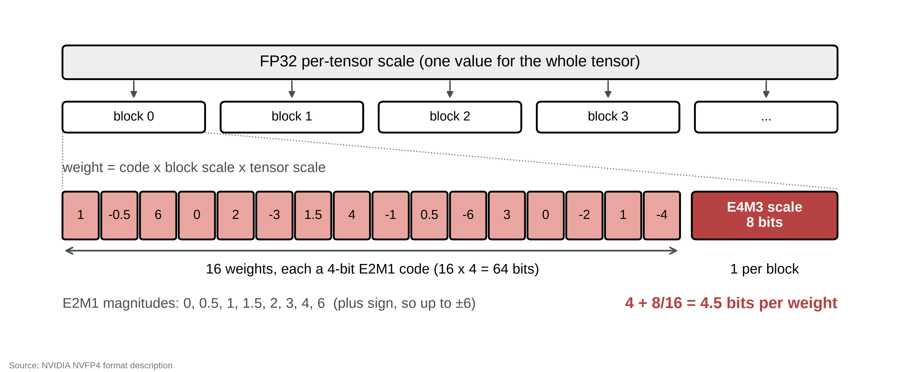
*The NVFP4 layout.*

I wanted it on a 3090. Sadly, I learned at the time that Ampere doesn't have native FP4. The FP4 forms of [`mma`](https://docs.nvidia.com/cuda/parallel-thread-execution/index.html#warp-level-matrix-instructions-mma), the PTX instruction that drives the tensor cores, need sm_120a, which is consumer Blackwell. Datacenter Blackwell does FP4 through a different instruction family, and nothing older has it at all.

NVFP4 checkpoints still run on Ampere, weight-only. The kernel unpacks the 4-bit weights into 16-bit floats in registers and does the multiply on the half-precision tensor cores. That path is called NVFP4A16, for NVFP4 weights with 16-bit activations. The weights stay small in memory, but every multiply waits on a decode first, and I assumed that had to be slower than a format the tensor cores understand directly, though I hadn't measured anything yet.

HINT4 is where I've ended up for now. It keeps the weights in 4 bits and does the math on 8-bit integer tensor cores, because that turned out to be the only tensor core instruction every NVIDIA GPU from Ampere to Blackwell runs natively. On Kimi-Linear 48B, plain HINT4 already had lower perplexity than NVFP4, and in isolated matrix multiplies on a 3090 it's about twice as fast as FP16 when decoding one token at a time, and slower at small batches.

## Integer instead

Ampere does have integer tensor cores, for INT8 and even INT4. My first idea, before I'd read the PTX docs properly, was a straight swap: INT4 wherever NVFP4 has FP4, INT8 wherever FP8 would go, keep the block scales, and run the whole thing on integer `mma`. I figured the integer part of the tensor core would be the part every generation keeps.

Then I found a paper that had already done the numerics. [Chen et al.](https://arxiv.org/abs/2510.25602) define NVINT4, which is NVFP4's exact structure with the E2M1 grid swapped for symmetric INT4, and their abstract says:

> for 4-bit formats, FP (e.g., MXFP4, NVFP4) often holds an accuracy advantage, though we show that NVINT4 can surpass NVFP4 when outlier-mitigation techniques like Hadamard rotation are applied.

NVINT4 lost to NVFP4 on all twelve models they tested, and won on all twelve once they added random Hadamard rotation. Their code only simulates the quantization, and the hardware half of the paper is a gate-level area and energy model of multipliers nobody has built yet. It mostly answers the accuracy question, with a rotation attached, but the hardware argument is about chips that don't exist yet, and I have a 3090. I also don't love the name. NVINT4 sounds like something NVIDIA ships, and it's a format from a paper.

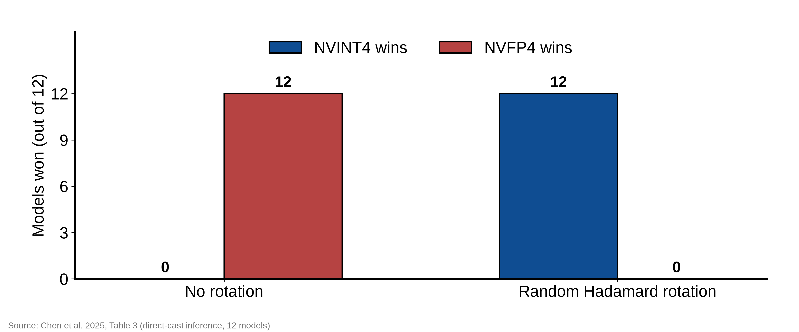
*From Table 3 of Chen et al.*

Do I emulate, and pay for a decode before every multiply, or go integer and trust that the instructions I need exist on every card I care about?

I also wanted every kernel to compile to the same native instruction on every GPU generation, so I wouldn't need an `if ampere / elif ada / elif hopper` in each one, or a separate copy per generation to keep in sync by hand. If that works it should be fast, and it's a lot less to maintain. I started calling it hardware-invariant, which is where the H in HINT4 comes from.

## Which integer mma?

PTX has both integer forms, the 4-bit `mma` and the 8-bit one, and [both are legal on anything from sm_80 up](https://docs.nvidia.com/cuda/parallel-thread-execution/index.html#warp-level-matrix-instructions-mma). Ampere runs both natively, so the first kernel used the 4-bit one, and on Ampere the SASS, the machine code ptxas emits, showed the real 4-bit instruction. My first README even put it in the name, Hardware-Invariant Native INT4 Microscaling, and claimed native INT4 tensor cores on Ampere and everything newer, Hopper included. Then I compiled the same kernel for sm_90 and looked at the SASS.

```
                     sm_80 / sm_86 / sm_89     sm_90
mma m16n8k32 .s4     IMMA.16832.S4.S4  x1      IMMA.16816.S8.S8  x2
mma m16n8k64 .s4     IMMA.16864.S4.S4  x1      IMMA.16832.S8.S8  x2
```

Where did the 4-bit instruction go?

Hopper doesn't have one. IMMA is the integer tensor core instruction, and in these kernels ptxas splits each 4-bit one into two 8-bit ones that each cover half the K dimension, with shifts and LOP3 logic ops in front to sign-extend the nibbles. It still runs on the tensor cores and still gets the right answer, but it isn't the instruction I wrote, and the extra work costs throughput. NVIDIA's own [table of tensor core input types](https://docs.nvidia.com/cuda/cuda-programming-guide/05-appendices/compute-capabilities.html#compute-capabilities-table-tensor-core-data-types-per-compute-capability) agrees. INT4 is there through compute capability 8.9 and gone from Hopper on, and INT8 is there on every row, every Blackwell part included.

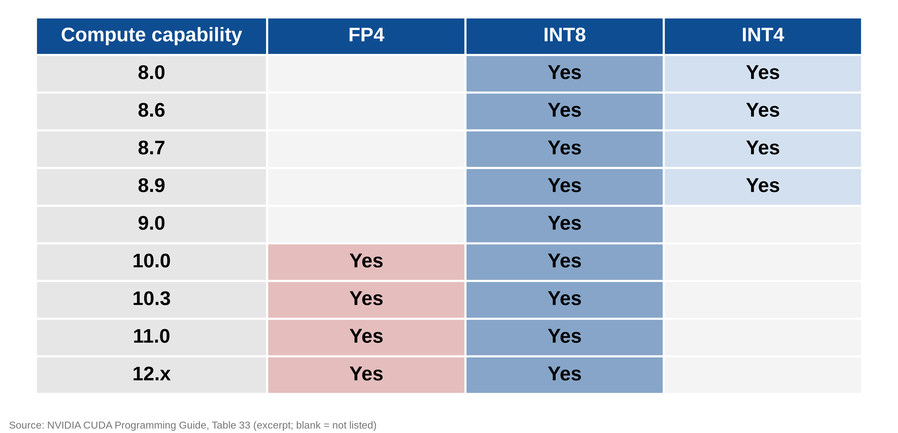
*Excerpt from Table 33 of NVIDIA's CUDA programming guide.*

Everything builds on the 8-bit `mma` instead, `mma.sync.aligned.m16n8k32` with signed bytes, which is native on every target I compile for, sm_80 through sm_120. The weights stay 4-bit in memory and get widened to signed bytes in registers right before the multiply. On Hopper, ptxas was doing more or less the same thing anyway. Now it happens in my source, the same way on every target.

Nine days after the first commit, the README title went from Hardware-Invariant Native INT4 Microscaling to Hardware-Invariant Native Integer-Tensor-Core 4-bit Microscaling. The new one is longer and doesn't promise 4-bit math.

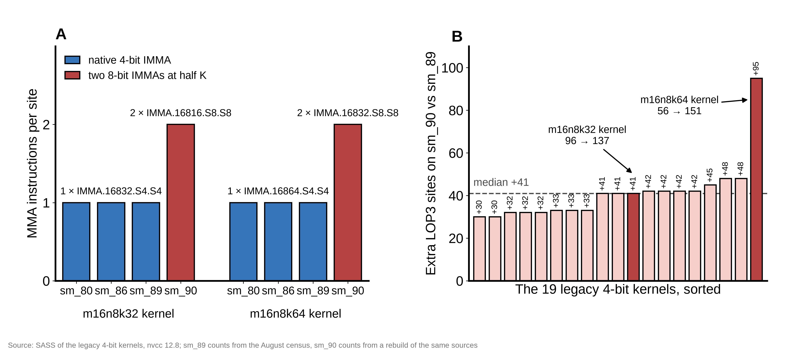
*The old 4-bit kernels compiled per target. On sm_90 each of the 19 needed between 30 and 95 extra LOP3s.*

After that I mostly trusted NVIDIA's table. This month I finally read the whole PTX ISA manual, both version 9.3 and the 8.7 one that shipped with CUDA 12.8, to see whether anything newer brings 4-bit integer math back.

Nothing does. Hopper's `wgmma` takes 8-bit integers and a 1-bit mode, and no 4-bit. Blackwell's `tcgen05` has one integer kind, `i8`, and the manual only lists it for sm_100a and sm_110a. The new `mma` kinds on consumer Blackwell are all floating point, FP4 included. The 8.7 manual even calls 4-bit `wmma` a preview feature with "no guarantees of backward compatibility on future PTX ISA versions or SM architectures". The 9.3 manual dropped that label.

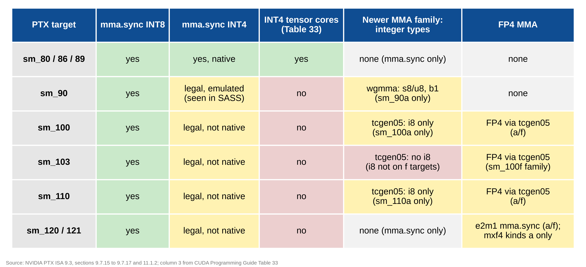
*Per target, from the PTX ISA 9.3 manual, plus what I saw in SASS on sm_90.*

The native FP4 instructions all need architecture-specific `a` targets or family-specific `f` targets. In the manual's words, code built for an `a` target "cannot be run on later generation devices", and `f` code only runs within its own family.

Nothing 4-bit, integer or FP4, runs as one native instruction from Ampere to Blackwell. My own 3090 does have native INT4 tensor cores, it's everything after Ada that doesn't.

## What the 8-bit math costs

An 8-bit `mma` needs both operands in INT8, so the activations get quantized to INT8 on the fly, on every call, with their own scales. NVFP4A16 never has to do that, and it's one more place for rounding error to come in. The products accumulate in INT32, and the weight and activation scales get applied to those integer sums.

When you generate one token at a time, the activation matrix has a single row, M=1, and an `mma` tile wants 16 rows, so fifteen of them would be padding. Small M goes through [DP4A](https://docs.nvidia.com/cuda/parallel-thread-execution/index.html#integer-arithmetic-instructions-dp4a) instead, a four-way byte dot product on the regular CUDA cores, so the batch-one path doesn't use the tensor cores at all.

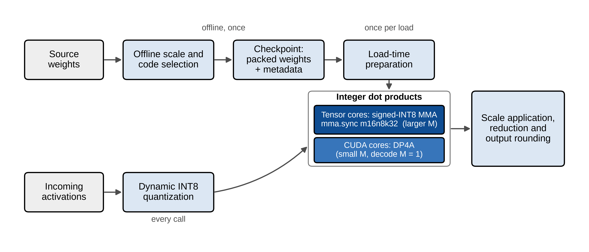
*The data path, from checkpoint to output.*

The block scales are E4M3, like NVFP4's, and the `cvt` instructions that convert E4M3 [need sm_89](https://docs.nvidia.com/cuda/parallel-thread-execution/index.html#data-movement-and-conversion-instructions-cvt) or newer. On the 3090 the compiler inlines a software decode instead, around forty instructions per scale byte where Ada does it in one. One of my older kernels did that decode inside the main loop over K, where it costs the most. I moved the decode out of the kernels. The scales get decoded once, before inference, and the prepared kernels never touch an FP8 byte.

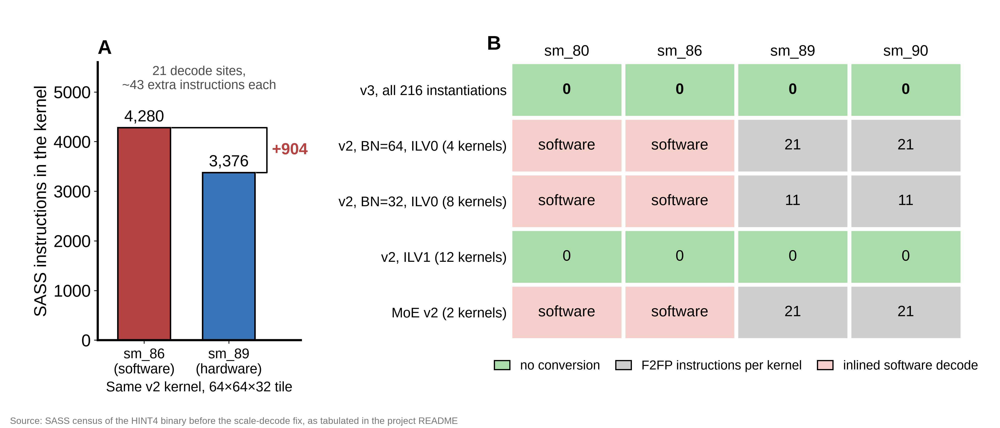
*The same older kernel compiled for sm_86 and sm_89, and where the E4M3 conversions sat in each kernel family before the decode moved out.*

## Does the model still work?

The quantizer I started with is the naive one, round-to-nearest with absmax block scales. The first real test was Kimi-Linear 48B on an 8×H100 machine, since a 48B model doesn't fit on a 3090. WikiText-2 perplexity went from 6.41 in BF16 to 6.54. NVFP4 scored 6.63 on the same windows with its math done exactly, and 6.71 through vLLM's faster Marlin kernels, so plain INT4 was already ahead of it here, without any rotation.

The usual fixes are [GPTQ](https://arxiv.org/abs/2210.17323), [AWQ](https://arxiv.org/abs/2306.00978) and rotation like [QuaRot](https://arxiv.org/abs/2404.00456), and I tried all three. Rotation took some care, because Kimi-Linear has linear attention with recurrent state, and a rotation only stays exact where you can fold it into the neighboring weights without crossing a nonlinearity or the recurrence. The Kimi port only rotated where that held.

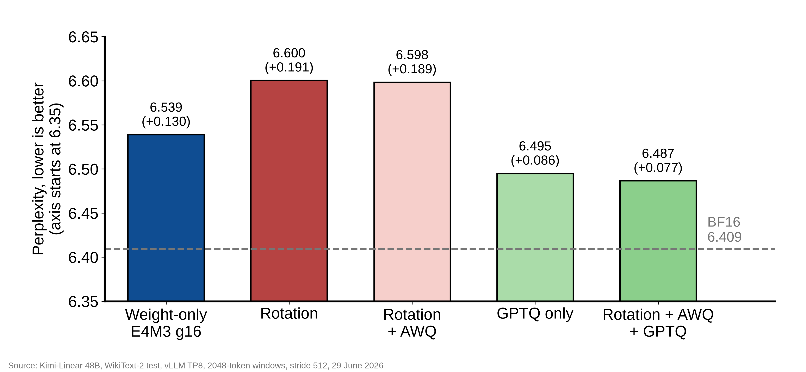
*Kimi-Linear 48B on WikiText-2, by preparation. The dashed line is BF16.*

Rotation alone made it worse, and adding AWQ on top barely moved it. Which is funny after the NVINT4 paper, where rotation is the whole reason integer wins. My own simulation on synthetic tensors agreed with the paper. A Hadamard rotation was worth more than 3 dB of SNR on a heavy-tailed tensor, more than 5 on one with outlier channels, and nothing on a plain Gaussian, since a rotated Gaussian is still Gaussian.

Rotation takes the few huge values that set a block's scale and spreads them across the block, so the grid stops spending its steps on one outlier, which only helps if there's a tail to spread. Kimi's MoE weights mostly didn't have one. Before any rotation, most of them had a kurtosis between 3 and 3.7, and a Gaussian's is 3.

Why would it hurt instead of just doing nothing, though? Reconstruction SNR with and without rotation was within a few hundredths of a dB, and perplexity and KL both got worse anyway. My guess is the error moved somewhere the model is more sensitive to, but I haven't checked where.

I think Kimi's near-Gaussian weights also explain why plain INT4 beat NVFP4 here when it lost everywhere in the paper. Chen et al. quantize the activations to 4 bits too and rotate both sides of every matmul, and in their own crest-factor analysis INT wins on blocks without big outliers and FP wins on blocks with them. My activations stayed at 8 or 16 bits, so only the weights mattered, and if I'm reading their analysis right, near-Gaussian weights are where INT should win and where rotation has nothing left to do.

GPTQ helped, closing about a third of the gap to BF16, which was most of what the full stack managed. An older report of mine said "about 80%" here because it mixed up those two denominators, so don't trust that number if you've seen it. GPTQ also needed 128 calibration sequences of 2048 tokens and a bit over two hours on the 8×H100.

In September I ripped all of it out anyway: GPTQ, AWQ, rotation and the calibration code. GPTQ and AWQ need calibration data, rotation rewrites the network itself, and I wanted something that takes a checkpoint and nothing else. The old 4-bit MMA kernels and an experimental 2:4 sparse family went out in the same cleanup, and I found a preset with rotation in its name that didn't rotate anything. It had been running as plain group-32 the whole time. Now it raises an error.

## What's left to tune

Absmax isn't the lowest-error scale for a block, so the packer tries a range of candidate scales and keeps whichever gives the lowest squared error, using nothing but the weights. E4M3 also rounds the scale itself. If it rounds down, the block's largest weight gets clipped, so the encoder rounds up in that case.

Some blocks fit an evenly spaced INT4 grid better and some fit FP4's uneven one, and I don't actually have to pick. Double every E2M1 magnitude and you get 0, 1, 2, 3, 4, 6, 8 and 12. Those are all integers, so an NVFP4-style FP4 block can run through the same INT8 `mma` with no extra error, just a different lookup when the nibbles get widened. E4M3 scales are always positive, which leaves their sign bit free, and I use it to mark which grid each block came from. I call this dual grid.

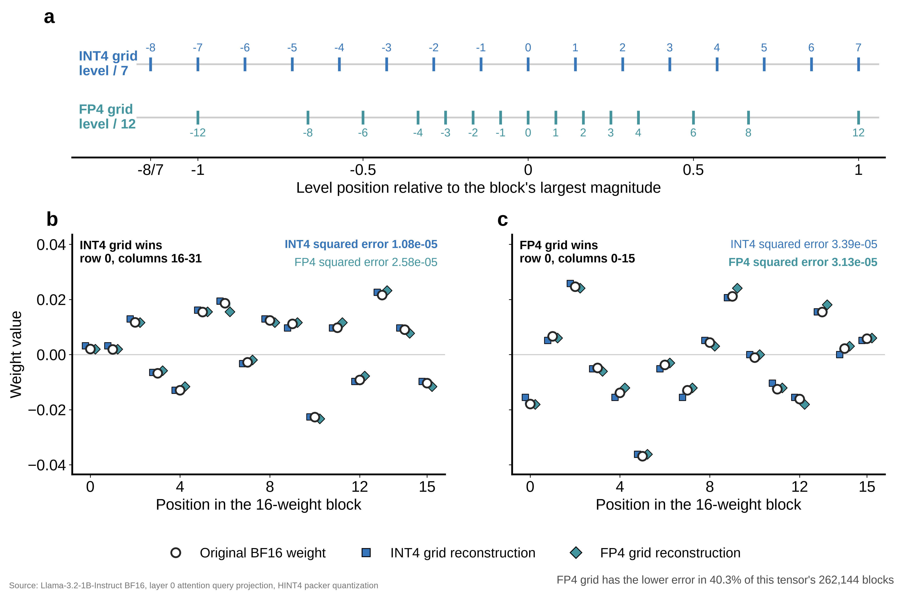
*Two real blocks from the first query projection of Llama-3.2-1B, one where each grid wins. Across that whole tensor, the FP4 grid wins about 40 percent of blocks.*

On Kimi, BBH logical deduction came out far below BF16, and below NVFP4 too. My first guess was that my weights reconstructed worse, so I measured every quantized tensor against BF16, more than 20,000 of them, and mine beat NVFP4's on all but 9. Then what was broken?

I started swapping things back. Put the BF16 weights back into one group of modules, leave everything else quantized, rerun the task, repeat. Putting all the attention weights back recovered nearly the whole gap on the five-object variant, and putting back only the output projection recovered most of it by itself. Storing that one projection as signed bytes, W8, together with the scale and grid changes above, closed the gap on that task.

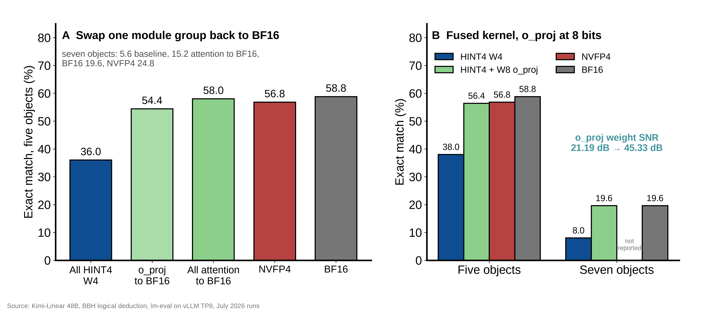
*Putting one group of Kimi's modules back in BF16 at a time, then the fused kernel before and after the 8-bit output projection.*

Smaller groups mean lower error, which is why NVFP4 uses 16, and so does classic HINT4, the plain version with one E4M3 scale per 16 INT4 weights. The 8-bit `mma` works through 32 weights at a time along K, though, so a scale every 16 weights means splitting every multiply in two.

TL, for two-level, is how I get around that. Each pair of 16-weight groups shares one E4M3 scale, and each group gets a small integer multiplier from one to eight, which gets folded into the weight bytes before the multiply. A 4-bit weight times eight still fits in a signed byte, so the math stays exact and one `mma` covers both groups, at the same 4.5 bits per weight as classic. Multiplier zero is reserved to mark an FP4 block, so dual grid still works inside TL.

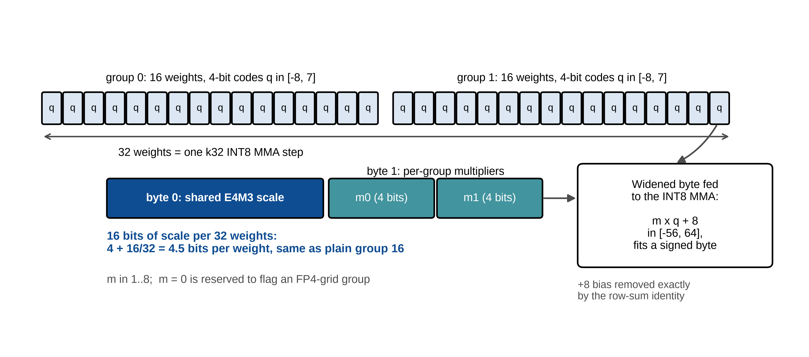
*Two 16-weight groups under one shared scale.*

Classic DQ, short for double quantization, quantizes the group scales a second time, with a small palette and a second level of scales, which brings classic under 4.5 bits. TL-DQ works differently despite the name. It's a dictionary over the final TL scale words, and expanding it gives back the exact TL scale stream, byte for byte, so it adds no error on top of TL. On Kimi it matched TL exactly with a checkpoint about a gigabyte smaller.

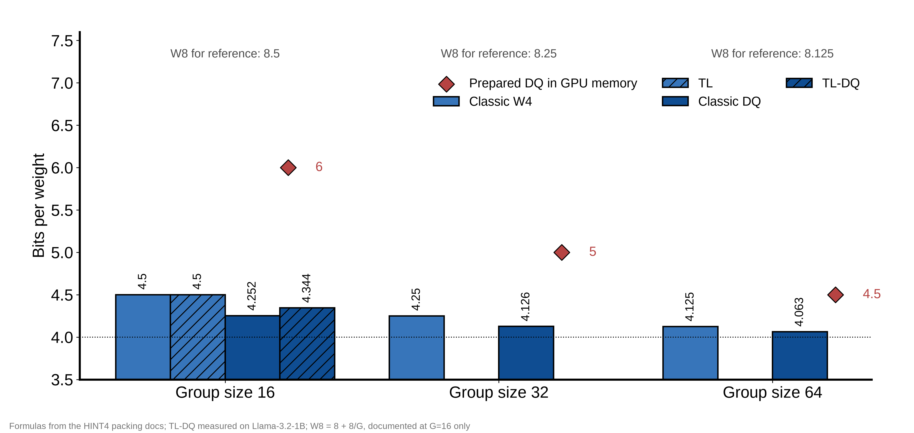
*Stored bits per weight by format and group size. The diamonds are prepared DQ once it's sitting in GPU memory.*

## Downstream tasks

Up to here I'd been scoring formats on reconstruction error and perplexity, and after logical deduction I didn't trust that much. In August I ran Llama-3.2-1B-Instruct through 19 tasks on an RTX A6000 with four configurations: BF16, TL-DQ, classic, and NVFP4A16. Every layer was 4-bit in those runs, which isn't true of the current default anymore.

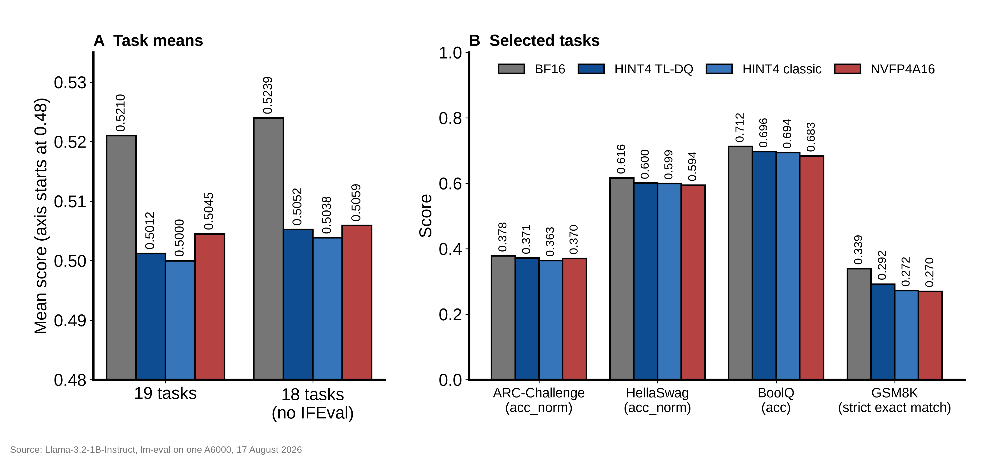
*Llama-3.2-1B-Instruct on an A6000, 17 August, with four of the 19 tasks broken out.*

All three quantized models landed below BF16, and NVFP4A16 had the best quantized average this time, a third of a point above TL-DQ. Most of that lead comes from IFEval, whose scorer turned out to be nondeterministic on a rerun, and without IFEval the gap is under a tenth of a point. Per task it goes both ways, with TL-DQ ahead on ARC-Challenge, HellaSwag, BoolQ and GSM8K.

On this model NVFP4's best-reconstructed tensor was worse than classic's worst, and NVFP4A16 still beat classic, on the average and on six separate downstream measurements across three harnesses. Within one format family I still rank variants by reconstruction error.

I can't run paired significance tests on any of this, because only the aggregate result files survived.

## Is it faster?

The A6000 has the same architecture as the 3090, but I wanted speed numbers from the card this is actually for. In September I timed 144 isolated matrix multiplies on the 3090: three layer shapes, six values of M, eight methods. At M=1, the decode case, TL-DQ was about twice as fast as FP16 on all three shapes.

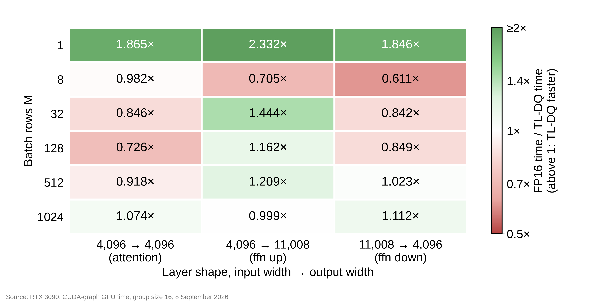
*FP16 time over TL-DQ time on the 3090. Green means TL-DQ was faster.*

The rest of the table is less fun. At M=8 TL-DQ was slower than FP16 on all three shapes, from 32 to 512 it depends on the shape, and by 1024 it's roughly even. Why would M=8 be slower everywhere when M=1 is twice as fast? I don't know yet. My guess is that batch one is waiting on memory, so moving about a quarter of the weight bytes pays off. Past that, FP16 on a 3090 is a strong baseline, and my kernel has to unpack weights and quantize activations on top.

My own earlier build was faster on every non-DQ decode case, by up to 44 percent, and the two builds were timed in separate runs instead of side by side, so I can't tell which change did it. A matrix multiply benchmark also has no attention, KV cache or scheduler in it, so none of these numbers are end-to-end speed.

Classic DQ's raw kernels rebuild the scales from the palette and the second-level scales on every single call. Prepared DQ does that once, at load time, and keeps the decoded scales as plain FP32 next to the packed weights. In the same binary on identical inputs, prefill came out about 6 to 13 times faster across 54 model-sized cases, small decode cases got slightly faster, and every output matched the raw path bit for bit. Keeping those FP32 scales resident costs memory. Four bits per weight plus an FP32 scale per group comes to 6 bits per weight at group size 16, 5 at 32 and 4.5 at 64, while the DQ checkpoint on disk is under 4.5 at every group size.

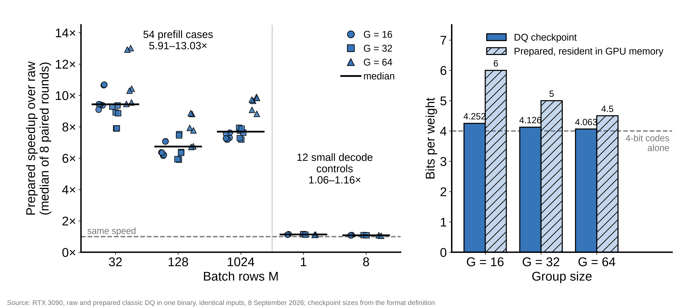
*Prepared over raw DQ, one point per case, and what it costs in GPU memory.*

Once the GPU work got that short, the Python side of each call started to show up in the timings. I added a handle that owns its own prepared copy of the weights, made warm DQ calls dispatch faster, cut down the routing work for small MoE batches, and gave quantized activations their own buffers. Across 70 comparisons, the time to launch a warm call dropped by about 30 to 55 percent, while GPU time inside a captured CUDA graph moved less than three percent either way. The older API, the one that lets you change weights in place, picked up 15 slower host timings across eight cases and a brief memory peak about 800 KiB higher in three large ones. I kept the change anyway.

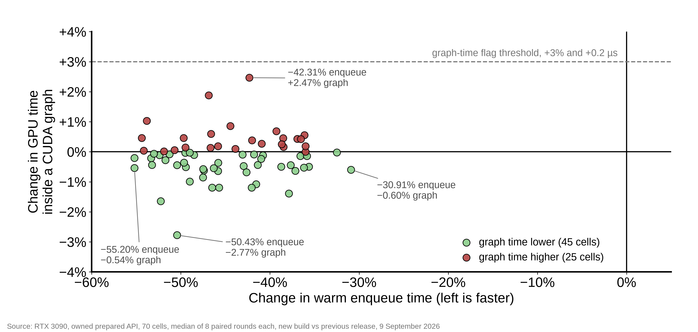
*One point per case, measured on the new handle.*

## Keeping it invariant

Hopper turned my 4-bit MMA into something else without any warning, so I don't trust the source to tell me what runs. Builds get a census now. I disassemble every kernel for sm_80, 86, 89, 90, 100 and 120 and look at the SASS. HMMA, the half-precision tensor core instruction, can't appear anywhere, so nothing falls back to FP16 math. 4-bit and sparse MMAs can't appear either, and every MMA has to match the one I wrote in the PTX, with the same operand types and shape.

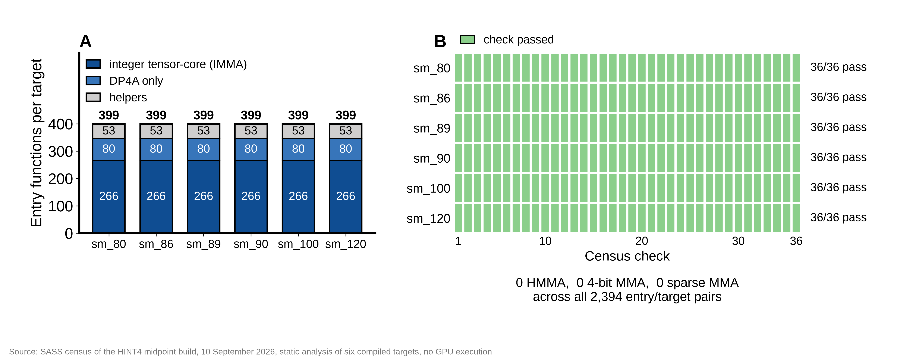
*The 10 September build on all six targets.*

The census only reads binaries, and the 3090 is the only GPU that has run and timed this build. For Blackwell all I have is compiled binaries with the right instructions in them.

A few lines in one helper end up compiled into a lot of kernels across six targets, so the census also shows when a change reaches further than it should. One change I kept was a rounding fix in the batch-one kernel. Quantizing an activation means computing 127·v/s and rounding to an integer, and the kernel does that with a fast reciprocal estimate and a multiply, which can round the wrong way when the exact value sits right on a .5. With FP16 inputs and ordinary positive FP16 scales, the midpoint that matters has a simple test: if 2·|v| equals s, the exact value is 63.5, round-to-nearest-even gives 64, and the new midpoint helper checks for that case.

I checked the fix on every possible FP16 input on the CPU, and compared the new helper with the old one almost a million times on the GPU, about a third of those against an FP64 reference, without a single mismatch. In the census, four kernels per target changed, the four I meant to change, and every other kernel matched the previous build instruction for instruction, control bits included.

In the timing runs, GPU time on four classic group-16 decode cases dropped 6 to 8 percent, under two microseconds each. Some host-side timings were still flagged in both the original and the repeat run, the controls included, so I'm only claiming the GPU side, for this one kernel.

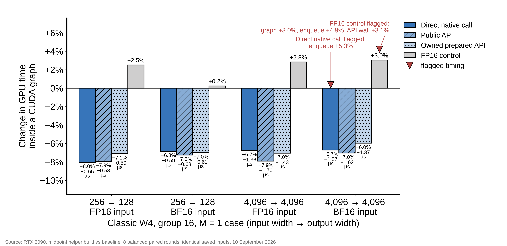
*The midpoint helper on four decode cases. The red markers are host timings that were still flagged as slower.*

I also wanted outputs to match across GPUs. Activation rounding is exact now, the dense kernel schedule is pinned to one profile that matches the 3090, so a GPU with more SMs can't pick a different K split or reduction order, and MoE outputs get added up in a fixed order. SiLU still uses the hardware's approximate exponential, though, so I can't promise bit-identical whole-model outputs across GPUs.

With the census and side-by-side timing both in place, a change could get rejected for being slower or for changing compiled code it shouldn't have touched, and several did.

| Change | What happened | Decision |
|---|---|---|
| Two-stripe GEMV | slower in 58 of 98 GPU timings | kept the old default |
| Compact DQ, lower prequant threshold | median got worse in 16 to 34 of 60 cases, depending on the timer | kept the old path and threshold |
| Split activation allocation | 2 MiB more reserved memory in 6 of 9 comparisons | rejected |
| Midpoint helper for TL and TL-DQ | 4.6% better median, but 2 of 12 cases missed the minimum gain and some host timings got worse | rejected |
| Midpoint helper for W8 | changed 66 kernels on both Blackwell targets that weren't supposed to change | rejected before timing |

The TL version of the midpoint helper came closest. Before the run I'd written down that every affected case had to clear a minimum gain, and two of the twelve didn't, so it stayed out even with a better median. The W8 version never got timed at all, so I don't know whether it would have been faster.

## The evaluation

The whole-model run happens on the same 3090, which is shared with other jobs, so the run needs the card to itself. I started from apaz's [gpumutex](https://github.com/apaz-cli/libgpumutex), which intercepts CUDA initialization and makes processes wait in line for a GPU. I run a pinned fork of it that gives up after a bounded wait and checks that its lock files are set up correctly before anything starts. That only keeps well-behaved processes off the card, so the evaluator also holds its own lease on the GPU, and the run checks that lease.

Each task run loads one model and sends the same fixed requests through it twice, in two separately supervised passes, and a shard of results only gets saved once both passes finish and agree. Scoring happens later, on the CPU, by replaying each task's scorer over the saved responses. When a worker dies, the next run picks up after the last complete shard, so nothing before that point needs the GPU again. Because scoring comes later, the campaign's progress counter can sit still while finished GPU work waits to be scored.

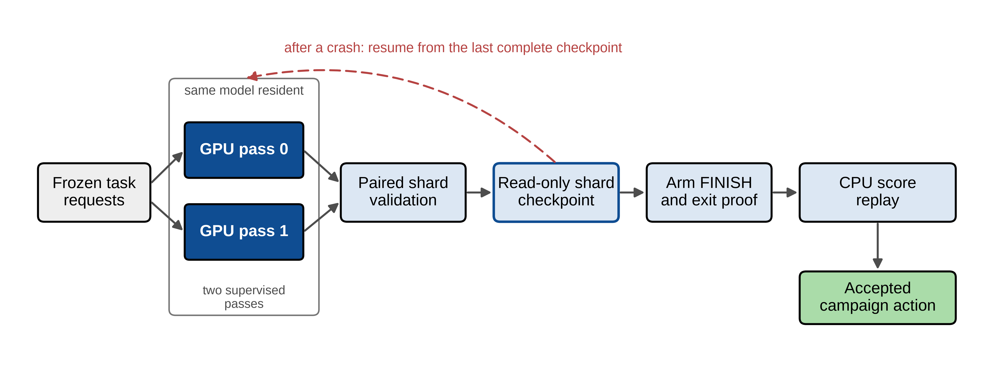
*How a shard becomes a score, and where a crashed run picks back up.*

The live run broke the evaluator a few times. Restarts got slower the longer the run went, until each result got computed only once. Startup had too much to do under one timeout, and it's split into separate steps with their own limits now. The finish check couldn't always tell a live process from a finished one once systemd had cleaned up the old cgroup or the lock had been renewed.

One MMLU question didn't fit at all. In the 8B BF16 run its four answer requests needed 672 blocks of KV cache together and there were only 575, and splitting a batch further can't help when it's already down to one question. For a case like that, the runner now caps how many requests run at once while still sending the same requests in one call. Three at a time needed 504 blocks. It goes back to the normal limit once the engine drains, and checks that both passes still agree.

Everything measured in this post comes from a saved result file. My own numbers have been wrong before on this project, once when a report of mine republished old results as if I'd just measured them, and once when the instruction counts in the docs drifted away from the binary they described.

## Where it is right now

As of 5 October 2026, 03:00 UTC.

The plan covers 17 configurations, 3 of Llama-3.1-8B-Instruct and 14 of Llama-3.2-1B-Instruct. Eight of them get the full set of tasks, and the other nine skip the tasks but still go through the format, perplexity and speed checks.

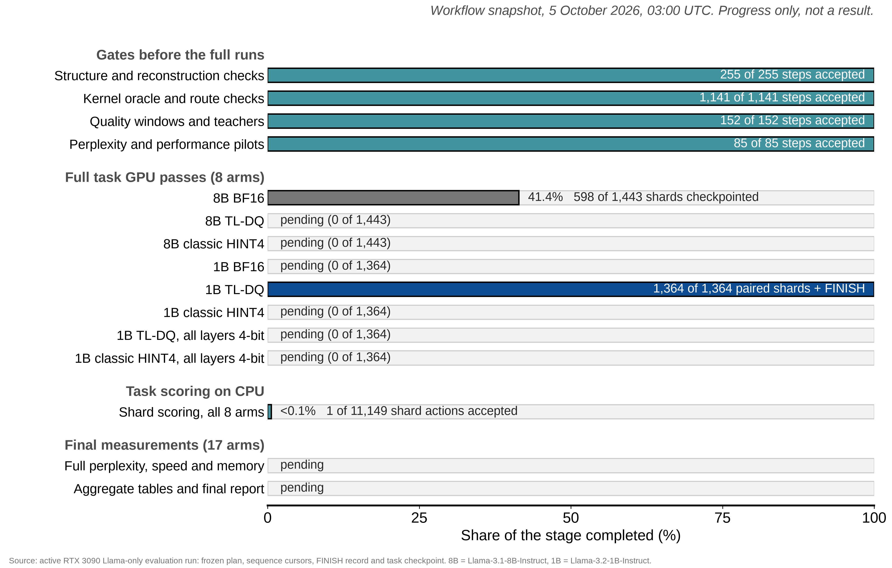
*Accepted work per stage of the plan.*

The 1B TL-DQ run has finished both passes on every shard, the 8B BF16 run is about 40 percent through, and CPU scoring has accepted one shard so far. Full perplexity, speed, memory and the final comparison haven't run yet.

DQ can only be evaluated as a whole model through plain Hugging Face Transformers for now, since vLLM can't load it yet. Kimi doesn't fit in 24 GiB at all, so it isn't part of the same-card comparison.

When the run finishes, report 2 gets perplexity with exact token counts, task scores from one setup, prefill and decode timings at fixed shapes, and peak memory, all from the same 3090.

## Open questions

A few things I don't know yet:

- Is the 8-bit `mma.sync` fast enough on datacenter Blackwell, where the fast path is `tcgen05` and `.kind::i8` isn't even listed for sm_103a? Nothing here has run on Blackwell yet.
- Is a native INT4 path for sm_80 through sm_89 worth breaking the one-kernel rule? It would have to bring 4-bit activations with it, since the 4-bit `mma` wants both operands in 4 bits.
- PTX 9.3 added an `mma_throughput` pragma that's "Supported on all target architectures". Does it help these kernels? I haven't tried it.

## Thanks

I did this as part of my RL Residency at [Prime Intellect](https://www.primeintellect.ai/), and I couldn't be more thankful to everyone there for the generous support, the compute and the reviews. Honorable mention to siro [@m_sirovatka](https://x.com/m_sirovatka), xeo [@xeophon](https://x.com/xeophon) and snimu [@omouamoua](https://x.com/omouamoua).
